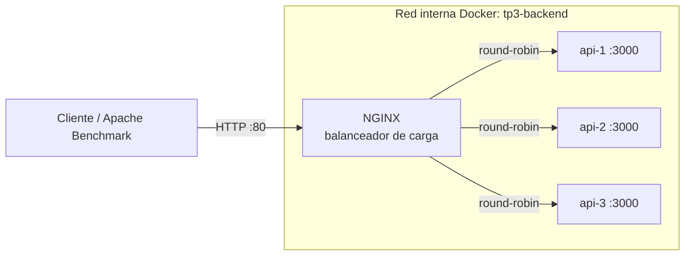

# TP3 - Despliegue de Arquitectura Cloud-Native

**Arquitectura de Sistemas – Ciclo 2026 · Licenciatura en Sistemas de Información**

Entorno de prueba para *GlobalLogistics S.A.* que demuestra escalado horizontal, balanceo de carga, health checks y comportamiento bajo estrés, definido íntegramente como **Infraestructura como Código** (Docker Compose).

## 1. Integrantes

| Integrante | Responsabilidad |
|---|---|
| Milagros Nievas | Fase 1 y 2: microservicio API y Dockerfile |
| Juan Nahuel Gorri | Fase 3 y 4: balanceador NGINX e infraestructura con Docker Compose |
| Agostina Molina | Fase 5 y final: pruebas de estrés y análisis crítico |

## 2. Arquitectura



- **1 balanceador NGINX**: único punto de entrada, publicado en el puerto `80` del host.
- **3 réplicas idénticas de la API**: no se publican al host; solo son accesibles a través de NGINX por la red interna.
- NGINX localiza a las réplicas por el **nombre del servicio** (`api`), que el DNS interno de Docker resuelve a las IPs de los tres contenedores.

## 3. Tecnologías

| Componente | Tecnología |
|---|---|
| Microservicio | Node.js 22 + Express (imagen `node:22-alpine`) |
| Balanceador | NGINX (imagen oficial `nginx:1.27-alpine`) |
| Orquestación / IaC | Docker Compose |
| Pruebas de carga | Apache Benchmark (`ab`) |

## 4. Estructura del repositorio

```
tp3-cloud-native-v2/
├── docker-compose.yml     # Infraestructura como Código: 1 NGINX + 3 réplicas
├── nginx/
│   └── nginx.conf         # Balanceo, proxy inverso y health checks pasivos
├── api/
│   ├── Dockerfile         # Imagen liviana de la API
│   ├── index.js           # Endpoints / y /health (devuelven el hostname)
│   ├── package.json
│   └── package-lock.json
├── .gitignore
└── README.md
```

## 5. Requisitos

Solo se necesita **Docker** con **Docker Compose v2** (incluido en Docker Desktop). No hace falta instalar Node.js ni NGINX.

El puerto `80` del host debe estar libre. Si está ocupado, ver la sección 11 (Solución de problemas).

## 6. Ejecución del entorno

Desde la raíz del repositorio:

```bash
docker compose up -d --build
```

> `docker compose up -d` (o `docker-compose up -d` en Docker Desktop) también funciona: construye la imagen automáticamente si no existe. Se usa `--build` para garantizar que se tome la última versión del código. Se requiere Compose v2: el antiguo `docker-compose` v1 ignora `deploy.replicas` y levantaría una sola réplica.

Verificar el estado:

```bash
docker compose ps
```

Resultado esperado: **4 contenedores**, con las tres réplicas en estado `(healthy)`.

```
NAME                          SERVICE   STATUS         PORTS
tp3-cloud-native-v2-api-1     api       Up (healthy)   3000/tcp
tp3-cloud-native-v2-api-2     api       Up (healthy)   3000/tcp
tp3-cloud-native-v2-api-3     api       Up (healthy)   3000/tcp
tp3-cloud-native-v2-nginx-1   nginx     Up (healthy)   0.0.0.0:80->80/tcp
```

> NGINX arranca recién cuando las réplicas pasan su health check (`depends_on: condition: service_healthy`).

## 7. Endpoints

Todos se acceden a través del balanceador (`http://localhost`):

| Método | Ruta | Atendido por | Descripción |
|---|---|---|---|
| GET | `/` | API | Mensaje de la API y `hostname` del contenedor que respondió |
| GET | `/health` | API | Estado de salud y `hostname` de la réplica |
| GET | `/nginx-health` | NGINX | Estado del propio balanceador |

Ejemplo de respuesta:

```json
{
  "mensaje": "API del TP3 - Arquitectura Cloud-Native",
  "estado": "funcionando",
  "hostname": "a3f9c21b7e04"
}
```

Dentro de Docker, el `hostname` es el ID corto del contenedor, lo que permite identificar qué réplica atendió cada petición.

## 8. Verificación del balanceo de carga

Enviar 6 peticiones consecutivas.

**PowerShell (Windows):**

```powershell
1..6 | % { (Invoke-RestMethod http://localhost/).hostname }
```

**Bash / Git Bash / Linux / macOS:**

```bash
for i in 1 2 3 4 5 6; do curl -s http://localhost/; echo; done
```

Resultado esperado: **tres hostnames distintos que se repiten en orden** (round-robin).

También puede verse en los logs de NGINX a qué réplica (`-> IP:3000`) se envió cada petición:

```bash
docker compose logs nginx
```

Cada respuesta incluye además la cabecera `X-Upstream-Server` con la IP de la réplica que respondió:

```bash
curl -i http://localhost/
```

## 9. Health checks y resiliencia

Se implementan dos niveles de health check:

| Tipo | Dónde | Funcionamiento |
|---|---|---|
| **Activo** | `docker-compose.yml` | Docker consulta `GET /health` de cada réplica cada 10 s. Tras 3 fallos la marca `unhealthy`. |
| **Pasivo** | `nginx.conf` | Si una réplica falla 3 veces en 10 s (`max_fails=3 fail_timeout=10s`), NGINX la saca de rotación por 10 s. Con `proxy_next_upstream`, la petición fallida se reintenta en otra réplica, sin que el cliente reciba error. |

> El `health_check` activo nativo de NGINX es exclusivo de NGINX Plus (versión comercial); por eso el chequeo activo se delega en Docker.

### Prueba de tolerancia a fallos

1. Detener una réplica (el nombre exacto se obtiene con `docker compose ps`):

   ```bash
   docker stop tp3-cloud-native-v2-api-2
   ```

2. Repetir las peticiones de la sección 8. Todas responden `200` y solo aparecen **dos** hostnames.

3. Volver a levantar la réplica:

   ```bash
   docker start tp3-cloud-native-v2-api-2
   ```

   A los pocos segundos vuelve a la rotación.

## 10. Pruebas de carga (Apache Benchmark)

Las pruebas se ejecutan **siempre contra el balanceador**, nunca contra una réplica directa. Se recomienda cerrar aplicaciones pesadas durante las pruebas para que la máquina que genera el tráfico no sea el cuello de botella.

### Opción A: sin instalar nada (recomendada)

Se ejecuta `ab` desde la imagen oficial `httpd`, conectada a la red interna del proyecto (`tp3-backend`) y apuntando al servicio `nginx`:

```bash
# Escenario 1 - Concurrencia moderada (100 usuarios concurrentes)
docker run --rm --network tp3-backend httpd:2.4-alpine ab -n 5000 -c 100 http://nginx/

# Escenario 2 - Concurrencia extrema (saturación)
docker run --rm --network tp3-backend httpd:2.4-alpine ab -r -n 20000 -c 1000 http://nginx/
```

### Opción B: con `ab` instalado en el host

```bash
ab -n 5000 -c 100 http://localhost/
ab -r -n 20000 -c 1000 http://localhost/
```

En Windows, `ab.exe` viene incluido en la distribución de Apache de [Apache Lounge](https://www.apachelounge.com/download/) (carpeta `bin`). En Linux, en el paquete `apache2-utils`.

| Parámetro | Significado |
|---|---|
| `-n` | Número total de peticiones |
| `-c` | Peticiones concurrentes (usuarios simultáneos) |
| `-r` | No abortar ante errores de socket. **Obligatorio en el escenario extremo**: sin él, `ab` se detiene en el primer `Connection reset by peer` y no genera reporte |

> La URL debe terminar en `/` (`http://localhost/`); de lo contrario `ab` la rechaza.

> En Windows, `ab.exe` con miles de peticiones puede agotar los puertos locales del sistema (error `10048`) y fallar por causas ajenas a la arquitectura. Por eso se recomienda la opción A.

### Guardar los resultados

```bash
docker run --rm --network tp3-backend httpd:2.4-alpine ab -n 5000 -c 100 http://nginx/ > resultados_c100.txt
```

Del reporte de `ab` se extraen: **Requests per second**, **Time per request** (latencia promedio), **Failed requests**, **Non-2xx responses** y la tabla *Percentage of the requests served within a certain time*, de donde salen los percentiles **p95** y **p99**.

### Monitoreo durante la prueba

En otra terminal, mientras corre `ab`:

```bash
docker stats
```

Permite ver si las réplicas llegan a su límite de CPU (50 % de un núcleo cada una, definido en `docker-compose.yml`).

Para identificar si fue NGINX quien empezó a rechazar conexiones:

```bash
docker compose logs nginx | grep -iE "worker_connections|upstream timed out|temporarily disabled|no live upstreams"
```

En PowerShell, reemplazar `grep -iE "..."` por `Select-String -Pattern "worker_connections|upstream timed out|temporarily disabled|no live upstreams"`.

| Mensaje en el log | Interpretación |
|---|---|
| `worker_connections are not enough` | NGINX agotó su pool de conexiones (cuello de botella en el balanceador) |
| `upstream timed out` / respuestas `504` | Las réplicas no respondieron en 5 s (cuello de botella en la CPU de las réplicas) |
| `upstream server temporarily disabled` | Una réplica superó `max_fails` y NGINX la sacó de rotación por 10 s |
| `no live upstreams` | Todas las réplicas quedaron fuera de rotación temporalmente |

> **`Failed requests: 0` no implica que no hubo fallos.** Con `proxy_next_upstream`, NGINX reintenta en otra réplica las peticiones que fallaron, por lo que el cliente recibe `200` pero con mayor latencia. Por eso hay que contrastar el reporte de `ab` con los logs de NGINX.

> **Capacidad del balanceador:** con `worker_processes auto`, NGINX crea un worker por núcleo de la máquina, y cada uno admite 1024 conexiones (cada petición usa 2). La capacidad máxima del balanceador depende entonces del equipo donde se ejecute la prueba, y debe informarse junto con los resultados.

### Comparación: 1 réplica vs. 3 réplicas

```bash
# Bajar a 1 réplica
docker compose up -d --scale api=1
docker compose restart nginx

# ...ejecutar las mismas pruebas...

# Volver a 3 réplicas
docker compose up -d --scale api=3
docker compose restart nginx
```

> **Importante:** NGINX resuelve el nombre `api` a las IPs de las réplicas **al iniciar**. Después de cambiar la cantidad de réplicas hay que reiniciarlo (`docker compose restart nginx`) para que tome las IPs nuevas.

## 11. Solución de problemas

| Problema | Solución |
|---|---|
| El puerto 80 está ocupado | En `docker-compose.yml`, cambiar `"80:80"` por `"8080:80"` y usar `http://localhost:8080/` |
| NGINX no arranca | Verificar que las réplicas estén `healthy` con `docker compose ps` y revisar `docker compose logs api` |
| Solo responden una o dos réplicas | Ejecutar `docker compose restart nginx` (ver nota de la sección 10) |
| Los cambios en el código de la API no se reflejan | Reconstruir con `docker compose up -d --build` |

## 12. Detener el entorno

```bash
docker compose down
```

## 13. Decisiones de diseño

- **Nombre de servicio en lugar de `localhost`**: dentro del contenedor de NGINX, `localhost` es el propio NGINX; las réplicas se alcanzan por el nombre `api` mediante el DNS interno de Docker.
- **Réplicas sin puertos publicados**: tres contenedores no pueden ocupar el mismo puerto del host y, además, así el balanceador es el único punto de entrada.
- **Round-robin**: las réplicas son idénticas y las peticiones homogéneas, por lo que un reparto equitativo es adecuado.
- **Zona de memoria compartida (`zone`)**: NGINX usa varios workers; sin una zona compartida, cada uno lleva su propio turno de round-robin y su propio conteo de fallos, y el reparto deja de ser ordenado.
- **Keepalive hacia las réplicas**: NGINX reutiliza conexiones TCP en lugar de abrir una por petición, reduciendo la latencia.
- **Límite de CPU por réplica (`0.50`)**: hace posible alcanzar la saturación en el escenario extremo y permite comparar de forma justa 1 réplica contra 3.
- **Health check con `127.0.0.1`**: en imágenes Alpine, `localhost` puede resolver a IPv6 (`::1`) mientras la API escucha en IPv4.
- **Red con nombre fijo (`tp3-backend`)**: los comandos de prueba funcionan igual sin importar el nombre de la carpeta donde se clone el repositorio.
- **Limitaciones del entorno de prueba**: NGINX es un punto único de falla, y Docker Compose no reemplaza automáticamente réplicas `unhealthy` (solo reinicia procesos que terminan). En producción se usaría un orquestador (Kubernetes, Docker Swarm) y balanceadores redundantes.

## 14. Repositorio

[tp3-cloud-native-v2 en GitHub](https://github.com/milinievas/tp3-cloud-native-v2)
